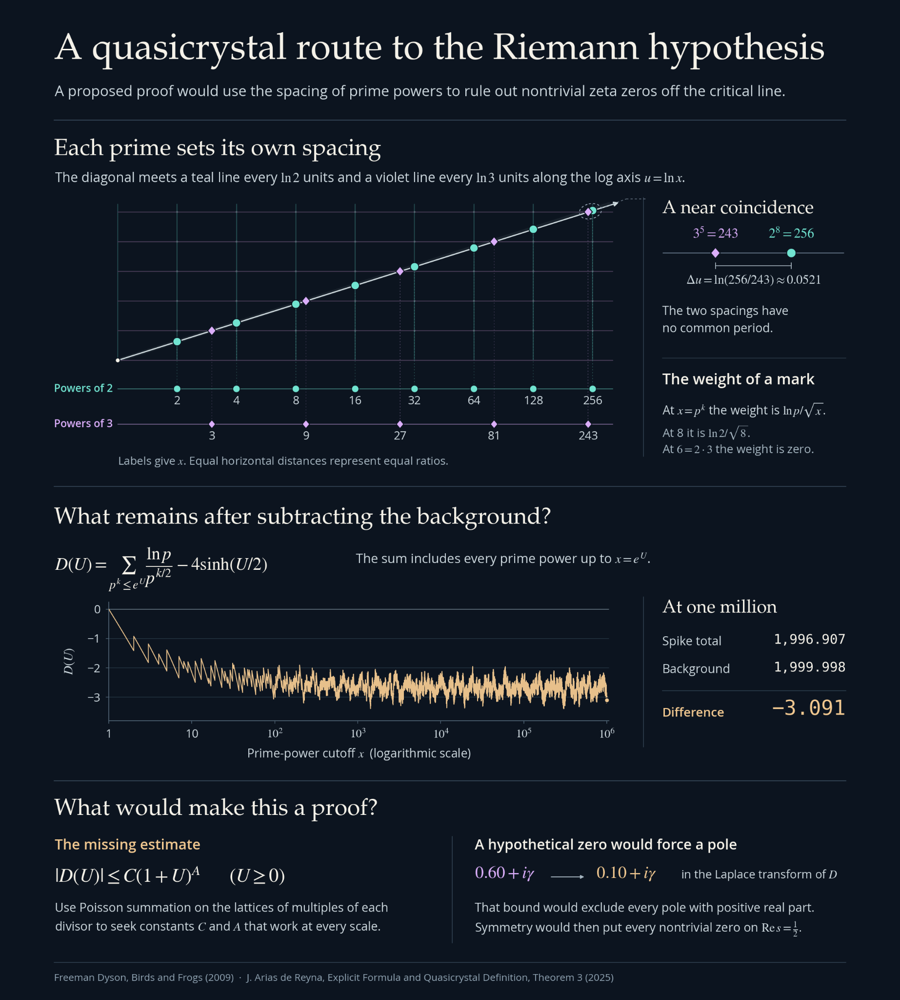
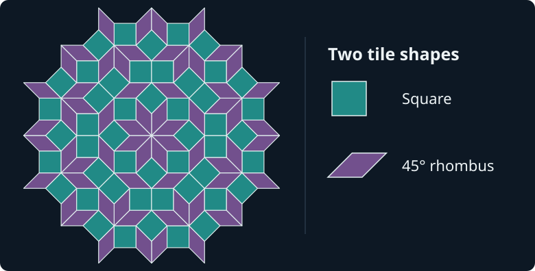
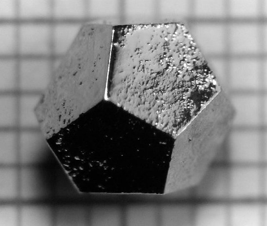
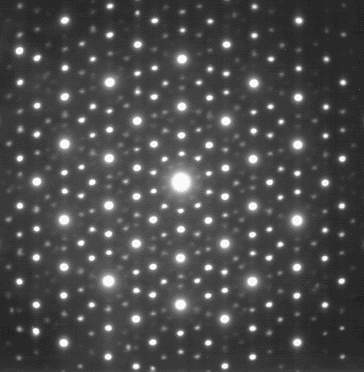

# From primes to zeros

The usual explicit formula starts with the zeros of the Riemann zeta function and reconstructs a staircase that jumps at prime powers. A zero $\rho$ contributes the oscillating term $-x^\rho/\rho$. **Run that picture backward. Can the locations and weights of the prime powers force every nontrivial zero onto the line $\mathrm{Re}(s)=1/2$?** This repository follows that question from a pair of nearby prime powers to the estimate an independent proof would need. [Von Mangoldt’s explicit formula, lecture 13](https://www2.math.uu.se/~ast10761/analtalt08/www_notes.pdf)

Freeman Dyson suggested classifying one-dimensional quasicrystals and looking for one that identifies the zeta zeros. Juan Arias de Reyna later gave a precise criterion involving a signed measure built from primes. The divisor-lattice experiment below explores one way to approach that criterion. [Dyson, *Birds and Frogs*](https://www.ams.org/notices/200902/rtx090200212p.pdf) · [Dyson’s quasicrystal passage](https://empslocal.ex.ac.uk/people/staff/mrwatkin/zeta/dyson-quasicrystal.htm) · [Arias de Reyna, Theorem 3](https://arxiv.org/html/2402.10604v2)

## Run the examples

From the repository directory, use Python 3.10 or later. All three commands use the standard library and print JSON.

~~~sh
python -m primes_to_zeros layers 6 8
python -m primes_to_zeros split 256 1000000
python -m primes_to_zeros poisson 64 128 256 --relative-width 0.125 --modes 64
~~~

## 1. Build the pattern from primes alone

Place the powers of each prime $p$ on the axis $u=\log x$. Powers of 2 appear every $\log 2$ units and powers of 3 appear every $\log 3$ units. A common period would imply $2^a=3^b$ for some positive integers $a,b$, contradicting unique factorization. The two families can still come close. The marks for $3^5=243$ and $2^8=256$ are separated by just $\log(256/243)\approx0.052116$. This is the quasicrystal intuition. Each family has a regular rhythm, and those rhythms have no shared period.

At both $u=k\log p$ and $u=-k\log p$, for $k\ge1$, place a spike of weight $\log p/p^{k/2}$. On the positive axis, the weight at 8 is $\log 2/\sqrt8$. The weight at 6 is zero. The explicit formula also supplies a continuous background of density $2\cosh(u/2)$. [Arias de Reyna, Theorem 3](https://arxiv.org/html/2402.10604v2)

Open the illustrated prime-power pattern

### Quasicrystal structure

**An eightfold tiling.** Follow the eight violet rhombi around the center. Rotating this patch by 45° brings each tile onto a tile of the same shape. The infinite Ammann–Beenker arrangement of squares and rhombi has no repeating unit cell. [Baake and Grimm, *Mathematical diffraction of aperiodic structures*](https://arxiv.org/abs/1205.3633) · [Code that draws this patch](figures/draw_ammann_beenker.py)

| A single quasicrystal grain | A measured electron-diffraction pattern |
|:---:|:---:|
|  |  |
| The pentagonal faces of this holmium–magnesium–zinc grain have edges about 2.2 mm long. [Photograph by Ames Laboratory, U.S. Department of Energy, public domain in the U.S.](https://commons.wikimedia.org/wiki/File:Ho-Mg-ZnQuasicrystal.jpg) | The bright spots mark directions where electron waves scattered by a quasicrystal in the same alloy family reinforce one another. [Image by Materialscientist](https://commons.wikimedia.org/wiki/File:Zn-Mg-HoDiffraction.JPG) · [CC BY-SA 3.0](https://creativecommons.org/licenses/by-sa/3.0/) |

Diffraction makes spatial order visible in frequency space. The arithmetic analogy begins with weighted points on a line at $k\log p$. The explicit formula connects their background-corrected pattern to the zeta zeros. [Arias de Reyna, Theorem 3](https://arxiv.org/html/2402.10604v2)

## 2. Identify the estimate that would force the zeros onto the line

Let $U\ge0$ and $X=e^U$. Count every spike up to and including $X$ on the positive side. Subtract the integral of the background to get

$$
D(U)=\sum_{p^k\le e^U}\frac{\log p}{p^{k/2}}-4\sinh(U/2).
$$

Both terms grow like $2e^{U/2}$ by the prime number theorem and partial summation. The target is to establish **fixed constants** $C,A\ge0$ such that $|D(U)|\le C(1+U)^A$ for **every** $U\ge0$. This would make the signed measure tempered, meaning that it acts continuously on smooth, rapidly decreasing test functions. One way to see the implication is to extend $D$ to an odd function on the line. A polynomially bounded function defines a tempered distribution, and so does its distributional derivative. That derivative is the spikes minus the background. Arias de Reyna uses the opposite overall sign and proves that temperedness of his measure is equivalent to RH. [Arias de Reyna, Theorem 3](https://arxiv.org/html/2402.10604v2)

**Where a zero enters.** For $\mathrm{Re}(z)>1/2$ the Laplace transform satisfies

$$
z\int_0^\infty e^{-zU}D(U)\,dU
=-\frac{\zeta'(\tfrac12+z)}{\zeta(\tfrac12+z)}
-\frac{1}{z-\tfrac12}-\frac{1}{z+\tfrac12}.
$$

The logarithmic derivative sums the prime-power spikes. The two rational terms subtract the background and cancel the zeta-pole contribution at $z=1/2$. A hypothetical zeta zero at $0.60+i\gamma$ would give the continued right-hand side a pole at $0.10+i\gamma$. The proposed polynomial bound would make the left-hand side holomorphic throughout $\mathrm{Re}(z)>0$. That excludes every zero to the right of $1/2$. The functional equation reflects any zero on the left to one on the right. [NIST DLMF, Eq. 27.4.12](https://dlmf.nist.gov/27.4.E12) · [NIST DLMF, reflection formula](https://dlmf.nist.gov/25.4.E3)

## 3. Rebuild the spikes from divisor lattices

On the ordinary integer axis, each divisor $d$ marks $d,2d,3d,\ldots$. Give its marks coefficient $-\mu(d)\log d$, where $\mu$ is the Möbius function. Adding the layers through $n$ gives the von Mangoldt function $\Lambda(n)$. Dividing by $\sqrt n$ gives the spike weight used in $D$. [Bucur, *Number Theory III*, Proposition 6.8](https://mathweb.ucsd.edu/~abucur/oldcourses/2014/104c/104cnotes15.pdf)

| At $n$ | Nonzero layer contributions | Spike weight |
|---|---|---|
| 6 | $\log 2+\log 3-\log 6=\log(6/6)=0$ | $0$ |
| 8 | $\log 2$ survives because $\mu(4)=\mu(8)=0$ | $\log 2/\sqrt8\approx0.245065$ |

The `layers` command combines the factors as integers before taking the logarithm, so the cancellation at 6 is exact. The `poisson` command moves a compact, twice continuously differentiable window along the log axis. For each center, it calculates the weighted spike total directly from prime powers, then from divisor multiples. A third calculation uses Poisson summation to express each divisor lattice in Fourier modes. The experiment also brackets the smooth background in that window. [Window, Fourier formula and error bound](docs/poisson.md)

## 4. Isolate the first spike from each prime

The `split` command sorts terms by their exponent $k$. For example, $16=2^4$ belongs to the higher-power group. At $X=1{,}000{,}000$ the calculation gives

| Exponent | Number of marks | Combined weight |
|---|---:|---:|
| $k=1$ | 78,498 | 1,989.068568422 |
| $k=2$ | 168 | 5.609510475 |
| $k\ge3$ | 68 | 2.228729919 |
| **All prime powers** | **78,734** | **1,996.906808816** |

Subtracting the background of $1{,}999.998$ gives **$D(\log 10^6)\approx-3.091191184$**. The reduction to the first spike also holds beyond this example.

- **Squares.** Put $L=U/2$. Their combined weight is $\sum_{p\le e^L}(\log p)/p$. Since $\log p\le L$ and $\sum_{2\le n\le e^L}1/n\le L$, the total is at most $L^2=U^2/4$.
- **Cubes and higher powers.** Even when every cutoff is removed, summing the geometric series for each prime gives a finite total.

$$
\sum_p\frac{\log p}{p^{3/2}(1-p^{-1/2})}
\le \frac{1}{1-2^{-1/2}}\sum_{n\ge2}\frac{\log n}{n^{3/2}}<\infty.
$$

**What remains to prove.** It is enough to bound $\sum_{p\le e^U}(\log p)/\sqrt p-4\sinh(U/2)$ by a polynomial in $U$ in absolute value. Restoring the squares adds at most $U^2/4$, and restoring all higher powers adds a bounded amount. The moving-window experiment measures finite examples of signed cancellation. Completing this route requires a uniform estimate that also recovers the sharp cutoff at every scale.

## Check or publish the repository

Run the tests with `python -m unittest discover -s tests -v`. To publish this checkout to your own GitHub account as a private repository, run the following from the repository directory with an authenticated GitHub CLI.

~~~sh
gh repo create from-primes-to-zeros --private --source=. --remote=origin --push
~~~
